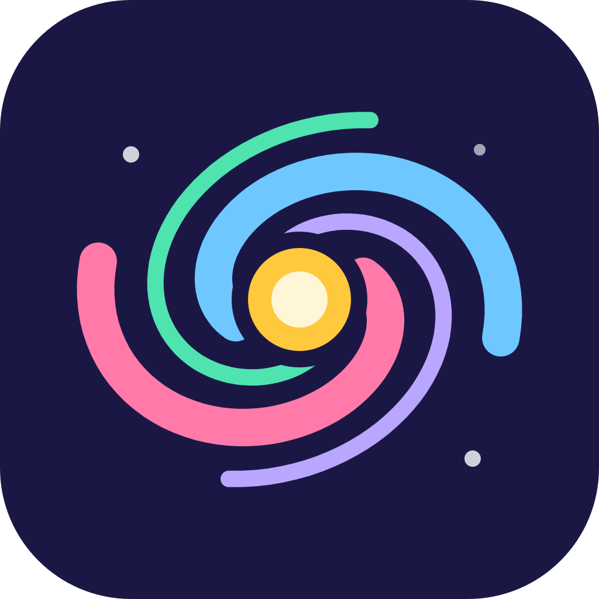

<p align="center">
  
</p>

<h1 align="center">NSL Nebular</h1>

<p align="center">
  เครื่องมือออกแบบและวางแผนพัฒนาซอฟต์แวร์แบบลากวาง สำหรับ Windows<br>
  <em>A drag-and-drop tool for designing and planning software projects (Windows desktop)</em>
</p>

<p align="center">
  <strong>รุ่นปัจจุบัน: Capella 0.7.0</strong> · <a href="CHANGELOG.md">บันทึกการเปลี่ยนแปลง</a>
</p>

---

ไฟล์โปรเจกต์ `.nsln` ไฟล์เดียวเก็บได้หลายเอกสาร: **ER, DFD, Flowchart, Wireframe, Screen Flow และ API** พร้อมความต้องการ (Requirements) โน้ต และประวัติเวอร์ชัน
สร้าง SQL สำหรับ **MySQL / MariaDB, PostgreSQL, SQLite และ SQL Server** สร้างโค้ดหลายเป้าหมาย และรัน Mock Server บนเครื่อง
ทำงานบนเครื่องของคุณทั้งหมด ไม่ต้องมีบัญชีหรืออินเทอร์เน็ต

## ความสามารถ

### โปรเจกต์หลายเอกสาร
- หน้าเริ่มต้น สร้างโปรเจกต์จากแม่แบบ ไฟล์ล่าสุด ; Project Home (ภาพรวม การ์ดเอกสาร ปัญหา) ; ตัวสำรวจโปรเจกต์พร้อมโฟลเดอร์ และจุดบอกเอกสารที่ยังไม่บันทึก
- **Flowchart** แบบ draw.io (รูปทรงมาตรฐาน จุดต่อเส้น smart guide จัดกลุ่ม จัดวางอัตโนมัติ) · **Wireframe** (ชิ้นส่วน UI 45 ชนิด เลเยอร์ รูปแบบร่าง/เรียบร้อย ผูกตาราง/คอลัมน์ ER) · **Screen Flow** (หน้าจอผูก Wireframe และเส้นการเปลี่ยนหน้า)
- **API Designer** (endpoint ผูกตาราง ER ส่งออก OpenAPI) · **Mock Server** บน localhost ตอบตามสัญญา API ด้วยข้อมูลจาก seed
- **สร้างโค้ด** หลายเป้าหมาย (ไม่ทับไฟล์ที่แก้ด้วยมือ) · **พจนานุกรมข้อมูล** · **Requirements + Traceability** · **โน้ต/งานค้าง** ปักหมุดบนแคนวาส · **ประวัติเวอร์ชัน + Diff**
- ตรวจปัญหาข้ามเอกสาร (เช่น ที่เก็บข้อมูล DFD หรือชิ้นส่วน Wireframe ชี้ตารางที่ไม่มีแล้ว) และ Export เอกสาร HTML/Markdown ทั้งโปรเจกต์

### แผนภาพ ER
- ลากวางตาราง คอลัมน์ ความสัมพันธ์ FK (เส้นหักมุมฉากแบบ crow's foot) จัดวางอัตโนมัติ
- กลุ่มตาราง (กรอบเส้นประ) โน้ตบนแคนวาส สีและฟอนต์ต่อตาราง สีเส้น FK
- เครื่องหมายทิศทางข้อมูลกลางเส้น FK และเส้นประวิ่งตามทิศทาง (ปิดได้ในเมนูมุมมอง)
- ตรวจปัญหาของ schema ก่อน Export (เช่น ไม่มี PK, ชนิดข้อมูล FK ไม่ตรงกัน)
- ข้อมูลตั้งต้น (Seed data) สร้าง `INSERT` แบบปลอดภัยรันซ้ำได้

### แผนภาพ DFD (Data Flow Diagram)
- ผู้ใช้ภายนอก (External entity), กระบวนการ (Process), ที่เก็บข้อมูล (Data store) และเส้นข้อมูลพร้อมป้ายชื่อ ทิศทางเดียวหรือสองทาง
- ตรวจกฎของ DFD ให้อัตโนมัติ (เส้นต้องผ่านกระบวนการ, กระบวนการต้องมีข้อมูลเข้า/ออก, เลขลำดับไม่ซ้ำ ฯลฯ)
- ปรับขนาดวัตถุด้วยการลากจุดจับ, จัดวางอัตโนมัติตามทิศทางข้อมูล, กรอบขอบเขตระบบ (ลากย้ายพร้อมวัตถุข้างใน), คัดลอก-วางข้ามแท็บ/ข้ามโปรเจกต์
- แตกรายละเอียดกระบวนการเป็นแผนภาพย่อย (Level 0 → Level 1) พร้อมตรวจความสมดุลของข้อมูลเข้า/ออก (balancing)
- ผูกที่เก็บข้อมูล (Data store) กับตารางใน ER และเตือนเมื่อตารางนั้นหายไป
- แท็บแผนภาพแบบแท็บเบราว์เซอร์ สร้างหลายแผนภาพในโปรเจกต์เดียว Undo/Redo แยกต่อแท็บ

### SQL และฐานข้อมูล
- สร้าง SQL ทั้ง 4 dialect และสลับ dialect ได้ทันที
- นำเข้าจากไฟล์ `.sql` หรือฐานข้อมูล เป็น ER ใหม่ในโปรเจกต์ แทนที่ ER ที่เปิดอยู่ (เลิกทำได้) หรือเปิดเป็นโปรเจกต์ใหม่ (ดูตัวอย่างใน [`samples/`](samples/README.md) รวมโปรเจกต์ตัวอย่างครบทุกชนิดเอกสาร `hotel_booking.nsln`)
- **Migration:** เปรียบเทียบกับไฟล์เก่าหรือกับฐานข้อมูลจริง แล้วสร้างสคริปต์แก้โครงสร้าง ห่อด้วย transaction และถามยืนยันก่อนทำสิ่งที่ลบข้อมูล
- **เชื่อมต่อ MySQL / MariaDB หรือเปิดไฟล์ SQLite แบบอ่านอย่างเดียว** (เมนู ไฟล์ → เชื่อมต่อฐานข้อมูล…, `Ctrl+Shift+O`): นำโครงสร้างเข้ามาเป็นแผนภาพหรือเปรียบเทียบเพื่อสร้าง migration (ตารางที่เปลี่ยนชื่อจับคู่ด้วยมือได้ ข้อมูลจะไม่หาย) · บันทึกการเชื่อมต่อไว้ใช้ซ้ำได้
- **รัน migration กับไฟล์ SQLite โดยตรง:** ยืนยันรายการที่ข้อมูลอาจหาย → สำรองไฟล์เดิมเป็น `.bak-วันเวลา` → รันในทรานแซกชัน (ผิดพลาดยกเลิกทั้งหมด) → อ่านกลับมาตรวจว่าตรงกับแผนภาพ
- **แก้โครงสร้างตารางด้วยฟอร์มแบบ phpMyAdmin** (`Ctrl+Shift+M`): ชื่อ ชนิด ความยาว ค่าเริ่มต้น Null Index A_I ของทุกคอลัมน์ในหน้าเดียว

### การใช้งาน
- **ช่องค้นหากลางแถบชื่อหน้าต่าง** (`Ctrl+K`): ค้นข้ามแท็บได้ทั้งคำสั่ง ตาราง คอลัมน์ วัตถุ DFD โน้ต กลุ่ม และปัญหา ตัวนำหน้า `@` ตาราง · `#` คอลัมน์ · `:` DFD · `!` ปัญหา · `>` คำสั่ง · `~` โน้ต
- **แถบสถานะล่าง:** รุ่นของโปรแกรม จำนวนตาราง ปัญหาที่ตรวจพบ ซูม สถานะบันทึก และปุ่ม **มีอะไรใหม่**
- Export ภาพ PNG/SVG (ธีมสว่าง/มืด, ทั้งกระดาน/เฉพาะส่วนที่มีตาราง/เฉพาะที่เลือก), Data dictionary (Markdown), Mermaid, DBML
- ธีมสว่าง/มืด, ภาษาไทย/อังกฤษ, ฟอนต์ Noto Sans Thai ฝังในโปรแกรม
- Auto-save และกู้คืนงานที่ค้างอยู่ ไฟล์โปรเจกต์ `.nsln` (JSON) — ไฟล์ `.nslm` และ `.erd` รุ่นเก่ายังเปิดได้ ไฟล์ `.nsld` ก็เช่นกัน และเมื่อบันทึกจะได้ไฟล์ `.nsln` ใหม่ (ไฟล์เดิมไม่ถูกแก้) ; เปิดไฟล์ด้วย `nsl_nebular.exe <ไฟล์>` ได้ ; ผูกสกุล `.nslm` กับแอปใน Windows (ดับเบิลคลิกเปิดได้) ด้วย `powershell -ExecutionPolicy Bypass -File tool\register_file_association.ps1` (เฉพาะผู้ใช้ปัจจุบัน ไม่ต้องใช้สิทธิ์ผู้ดูแล ; `-ExePath` ระบุตำแหน่งแอป, `-IncludeLegacyErd` ผูก `.erd` ด้วย, `-Unregister` ถอนออก)
- กด `F1` เพื่อดูคีย์ลัดทั้งหมด (Redo = `Ctrl+Shift+Z`, `Ctrl+Y` หรือ `Alt+Z`)

## ติดตั้ง (ผู้ใช้ทั่วไป)

1. ดาวน์โหลดไฟล์ `NSL_Nebular_<รุ่น>_windows_x64.zip` จากหน้า **[Releases](../../releases)**
2. แตกไฟล์ทั้งโฟลเดอร์ แล้วเปิด `nsl_nebular.exe` (เก็บ `flutter_windows.dll` และโฟลเดอร์ `data` ไว้ข้างกัน)

**ข้อกำหนด:** Windows 10/11 (64 บิต) และ [Microsoft Visual C++ Redistributable (x64)](https://learn.microsoft.com/cpp/windows/latest-supported-vc-redist)
โปรแกรมยังไม่ได้เซ็นดิจิทัล Windows SmartScreen อาจเตือน ให้เลือก "ข้อมูลเพิ่มเติม" → "เรียกใช้อยู่ดี"

## Build จากซอร์ส

ต้องมี [Flutter](https://docs.flutter.dev/get-started/install/windows/desktop) (Dart SDK ^3.13) และ Visual Studio พร้อมชุด "Desktop development with C++"
และเปิด **Developer Mode** ของ Windows (ปลั๊กอินใช้ symlink)

```bash
flutter pub get
flutter run -d windows            # รันแอป
flutter build windows --release   # ผลลัพธ์: build/windows/x64/runner/Release/
flutter test                      # เทสต์ทั้งหมด
flutter analyze
```

เปลี่ยนไอคอน Windows จาก `assets/icon/app_icon.png`: `flutter test tool/gen_app_icon_test.dart`

### พัฒนาคู่กับ NSL-UI-Core

สี รูปทรง และธีมของแอปมาจากแพ็กเกจ [`nsl_ui`](https://github.com/LittleSoldier2185/NSL-UI-Core) (ใช้ร่วมกับแอป NSL อื่น)
`pubspec.yaml` ชี้ไปที่ git จึง build ได้ทุกเครื่องโดยไม่ต้องมีโฟลเดอร์อื่นอยู่ข้างกัน

ถ้าต้องแก้ Core คู่กับแอปในเครื่อง ให้มีโฟลเดอร์ `NSL-UI-Core` อยู่ข้างโฟลเดอร์นี้ และสร้างไฟล์ `pubspec_overrides.yaml` (อยู่ใน `.gitignore` ไม่เข้า git):

```yaml
dependency_overrides:
  nsl_ui:
    path: ../NSL-UI-Core
```

แล้วรัน `flutter pub get` — ลบไฟล์นี้เมื่อต้องการกลับไปใช้ git ; **แก้ Core แล้วต้อง push Core ก่อน** แอปบนเครื่องอื่นถึงจะเห็นการเปลี่ยนแปลง

## ใช้กับ Claude Code (CLI + MCP server)

Nebular มีเครื่องมือบรรทัดคำสั่งและ MCP server ให้ Claude Code (หรือตัวคุณเอง) อ่าน ตรวจ ส่งออก และสร้างโค้ดจากไฟล์โปรเจกต์ได้โดยไม่ต้องเปิดโปรแกรม — **ออฟไลน์ล้วน ไม่มี host/บัญชี/พอร์ต** (MCP ใช้ stdio: Claude Code เปิดเป็นโปรเซสลูกในเครื่อง)

**อ่านไฟล์โปรเจกต์อย่างเดียว ไม่แก้ไฟล์โปรเจกต์** (ปลอดภัยแม้เปิดไฟล์เดียวกันในโปรแกรมอยู่) ; เขียนได้เฉพาะปลายทางที่สั่ง (`export --out`, `codegen --out`) และการสร้างโค้ดจะไม่ทับไฟล์ที่ถูกแก้ด้วยมือ

### สร้าง exe

```powershell
powershell -ExecutionPolicy Bypass -File tool\build_cli.ps1
# → build\cli\nebular\bundle\bin\nebular.exe          (CLI)
# → build\cli\nebular-mcp\bundle\bin\nebular_mcp.exe  (MCP server)
```

ไม่อยากสร้าง exe ใช้ `dart run bin/nebular.dart …` / `dart run bin/nebular_mcp.dart` ได้ (เริ่มช้ากว่า ~2 วินาที)

### CLI

```
nebular info      shop.nsln                       ภาพรวม (เอกสาร ตาราง endpoint ปัญหา)
nebular docs      shop.nsln                       รายการเอกสาร (id ชนิด ชื่อ)
nebular show      shop.nsln "Shop API"            เนื้อหาเอกสารเป็น JSON
nebular validate  shop.nsln [--json] [--min-severity error|warning|info] [--lang en]
                                                  ตรวจทั้งโปรเจกต์ — จบด้วยรหัส 1 ถ้าพบ error (ใช้ใน CI ได้)
nebular export    shop.nsln --format markdown|html|sql|openapi [--out ไฟล์]
nebular targets   [shop.nsln]                     เป้าหมายสร้างโค้ด (ใส่ไฟล์ = บอกว่าตัวไหนสร้างได้)
nebular codegen   shop.nsln --targets sqlDdl,typescript|all --out โฟลเดอร์ [--dry-run] [--overwrite-edited]
```

รหัสจบ: `0` สำเร็จ · `1` validate พบ error · `2` ใช้ผิด/ผิดพลาด

### MCP server (Claude Code)

เพิ่มใน `.mcp.json` ของโฟลเดอร์โปรเจกต์ที่ใช้ Claude Code (หรือ `claude mcp add nebular -- <path>`):

```json
{
  "mcpServers": {
    "nebular": { "command": "D:\NSL Product\NSL-Nebular\build\cli\nebular-mcp\bundle\bin\nebular_mcp.exe" }
  }
}
```

เครื่องมือ (ทุกตัวรับ `path` ของไฟล์ `.nsln`; path สัมพัทธ์อิงโฟลเดอร์ที่เปิด Claude Code):

| เครื่องมือ | ทำอะไร | เขียนไฟล์ |
|---|---|---|
| `nebular_project_info` | ภาพรวมโปรเจกต์ | ไม่ |
| `nebular_list_documents` | รายการเอกสาร (id ชนิด ชื่อ) | ไม่ |
| `nebular_read_document` | เนื้อหาเอกสารเป็น JSON | ไม่ |
| `nebular_validate` | ตรวจปัญหาทั้งโปรเจกต์ | ไม่ |
| `nebular_export` | ส่งออกเป็นข้อความ (markdown/html/sql/openapi) | ไม่ |
| `nebular_export_to_file` | ส่งออกลงไฟล์ | ไฟล์ที่ระบุ |
| `nebular_list_codegen_targets` | เป้าหมายสร้างโค้ดที่สร้างได้ | ไม่ |
| `nebular_codegen_preview` | ดูไฟล์ที่จะสร้าง (ยังไม่เขียน) | ไม่ |
| `nebular_codegen_write` | สร้างโค้ดลงโฟลเดอร์ (ไม่ทับไฟล์ที่แก้ด้วยมือ) | โฟลเดอร์ที่ระบุ |

ข้อจำกัด: เครื่องมืออ่านได้เฉพาะไฟล์สกุลโปรเจกต์ (`.nsln` / `.nsld` / `.nslm` / `.erd`) ; **ยังแก้โปรเจกต์ผ่านเครื่องมือไม่ได้** (เพิ่มตาราง ฯลฯ ต้องทำในโปรแกรม) ; ผลลัพธ์ที่ยาวเกิน 60,000 ตัวอักษรถูกตัด (ปรับด้วย `max_chars`)

## โครงสร้างโปรเจกต์

```
lib/
  core/        ตรรกะล้วน ๆ ไม่ผูกกับหน้าจอ: models, ddl (สร้าง SQL), diff (migration), parser (นำเข้า .sql),
               layout (วางตาราง/เส้น), export, validate, db (เชื่อมต่อ MySQL), l10n (ไทย/อังกฤษ)
  state/       ProjectController, DfdController, AppSettings (ChangeNotifier)
  ui/          หน้าจอทั้งหมด: canvas, dfd, panels, dialogs, ฯลฯ
  cli/         แกนของ CLI และ MCP server (Dart ล้วน)
bin/           nebular.dart (CLI) · nebular_mcp.dart (MCP server)
windows/runner/  โค้ดฝั่ง Windows (แถบชื่อหน้าต่างแบบกำหนดเอง)
design/        ดีไซน์หน้าตาโปรแกรม (สำเนา Artifact) — ดู design/README.md
samples/       ไฟล์ SQL ตัวอย่างสำหรับทดสอบ
test/          เทสต์ (unit + widget)
```

## เลขรุ่นและชื่อรุ่น

เลขรุ่นเป็น [SemVer](https://semver.org/) (`0.5.0`) ตามด้วยชื่อรุ่นเป็นดาว เรียงตามตัวอักษรทีละรุ่นที่เลขรองเพิ่ม:
0.5 Altair → 0.6 Betelgeuse → 0.7 **Capella** → 0.8 Deneb → 0.9 Elnath → 1.0 Fomalhaut
ขั้นตอนขึ้นรุ่นใหม่และสถานะงานปัจจุบันดูที่ [`progress.md`](progress.md)

## ความปลอดภัยของข้อมูล

- การเชื่อมต่อฐานข้อมูลเป็น **อ่านอย่างเดียว**: ปฏิเสธทุกคำสั่งที่ไม่ใช่ `SELECT / SHOW / DESCRIBE / EXPLAIN` และตั้ง session เป็น `READ ONLY` ที่ฝั่งเซิร์ฟเวอร์ด้วย
- **รหัสผ่านไม่ถูกบันทึก เว้นแต่คุณติ๊ก "จำรหัสผ่าน" เอง** — ค่าเริ่มต้นอยู่ในหน่วยความจำระหว่างเชื่อมต่อเท่านั้น ถ้าเลือกจำ จะเก็บเฉพาะข้อความที่เข้ารหัสด้วย Windows DPAPI (ผูกกับบัญชี Windows ของคุณ ไฟล์ที่ก๊อปไปเครื่อง/บัญชีอื่นถอดไม่ได้) ไม่มีรหัสผ่านเป็นข้อความเปล่าในไฟล์ใด ๆ
- ไฟล์ SQLite เปิดด้วยโหมดอ่านอย่างเดียว ; การรัน migration กับไฟล์ SQLite เป็นปุ่มแยกที่ต้องยืนยันและสำรองไฟล์ก่อนเสมอ
- สคริปต์ migration ห่อด้วย transaction และมีคำเตือนก่อนคำสั่งที่ลบข้อมูล

## ลิขสิทธิ์และฟอนต์

ฟอนต์ **Noto Sans Thai** ที่ฝังในโปรแกรมใช้ภายใต้ [SIL Open Font License 1.1](assets/fonts/OFL.txt)

---

## English summary

**NSL Nebular** is a Windows desktop app for designing and planning software by drag and drop. One `.nsln` project file holds ER, DFD, Flowchart, Wireframe, Screen Flow and API documents, plus requirements, notes and version history. It generates SQL for MySQL/MariaDB, PostgreSQL, SQLite and SQL Server, generates code for several targets, and runs a local mock server.

- **ER diagrams:** tables, columns, FK relationships (orthogonal crow's-foot lines), groups, notes, auto-layout, schema validation, seed data
- **DFD diagrams:** external entities, processes, data stores and labeled data flows with automatic rule checking
- **More documents:** draw.io-style Flowchart, Wireframe (45 UI components, layers, ER binding), Screen Flow, API Designer with OpenAPI export and a localhost Mock Server; data dictionary, requirements/traceability, notes, version history and diff
- **Claude Code:** an offline CLI and MCP server (stdio) to read, validate, export and generate code from a project
- **SQL:** import `.sql` or a database as a new ER, replacing the open ER (undoable) or as a new project; migration scripts (transaction-wrapped, with confirmation before destructive steps), read-only MySQL/MariaDB connection
- **Search:** a box in the title bar (`Ctrl+K`) that finds commands, tables, columns, DFD objects, notes, groups and issues across tabs (prefixes `@ # : ! > ~`)
- Export PNG/SVG (light/dark), Markdown data dictionary, Mermaid, DBML; Thai/English UI; light/dark theme

**Install:** download the zip from [Releases](../../releases), extract the whole folder and run `nsl_nebular.exe` (needs the Microsoft Visual C++ Redistributable x64).
**Build:** `flutter pub get` → `flutter run -d windows` (Windows Developer Mode required). Tests: `flutter test`.
The Noto Sans Thai font is used under the SIL Open Font License 1.1.
